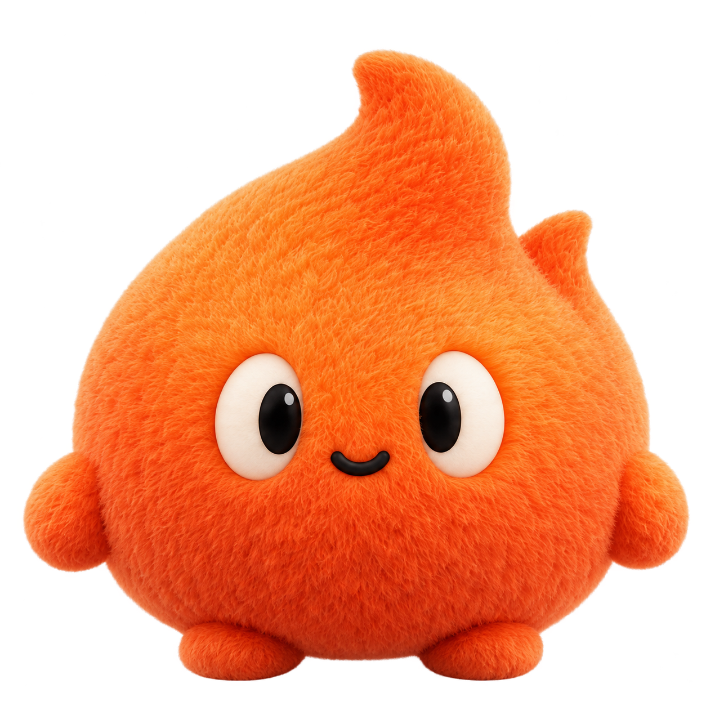

# Flame brand identity

Flame is a small, rounded orange flame with a curious, friendly presence. Its
compact body, two simple eyes and asymmetrical flame tips make the identity
recognizable across application icons, avatars and larger illustrations.

## Primary logo

  

Use the primary logo for application icons, navigation, avatars and other compact
surfaces. Keep the rounded silhouette and both eyes intact.

[Download the transparent PNG](flame-mark.png)

## Companion characters

| 3D companion                                                                       | Plush character                                                          |
| ---------------------------------------------------------------------------------- | ------------------------------------------------------------------------ |
|              |     |
| A soft, dimensional expression for product introductions and larger illustrations. | A warm, tactile expression for welcoming moments and brand storytelling. |
| [Download PNG](flame-companion.png)                                                | [Download PNG](flame-plush.png)                                          |

All three assets have transparent backgrounds. These files are shared by the
repository documentation and **Settings → Brand identity** in the application.

## Brand color

| Format     | Value                    |
| ---------- | ------------------------ |
| Name       | Flame Orange             |
| HEX · sRGB | `#FB6E30`                |
| RGB        | `251, 110, 48`           |
| HSL        | `18.33°, 96.21%, 58.63%` |

Use the exact HEX value for flat brand fills. Dimensional and plush renderings
include lighting and material variation; sampling their pixels does not define a
new brand color. Appearance themes may adapt interface contrast, while the brand
assets retain their original color.

## Use

- Preserve proportions, expression and flame tips. Leave room around the mark.
- Keep the primary logo simple at small sizes; use the companion characters when
  there is room for material and facial detail.
- Use a clear background that keeps the orange silhouette and dark eyes visible.
- Keep the original colors and avoid adding outlines, glow or extra decorations.

The original concept boards and refinement prompts remain under
[`design/branding/`](../../design/branding/). The transparent production assets were
prepared from the approved rounded concepts with the built-in imagegen tool;
their extraction prompts are recorded in [`prompts.txt`](prompts.txt).
